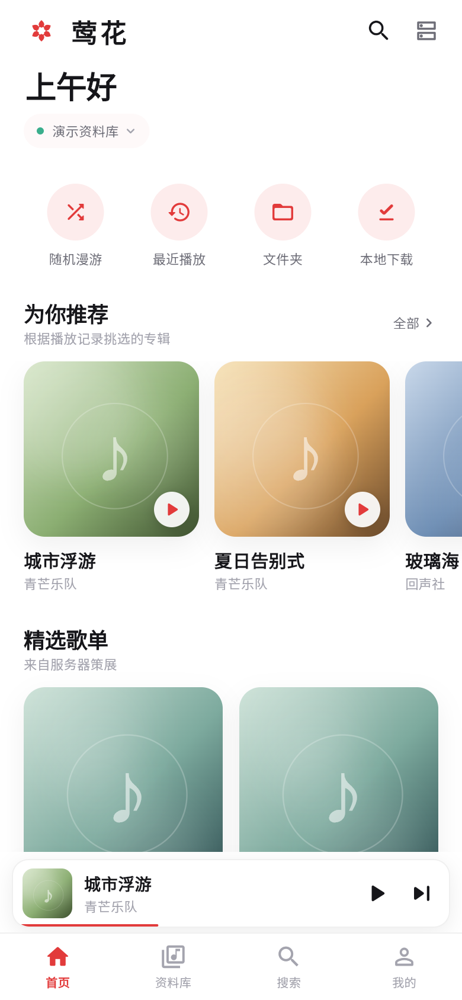
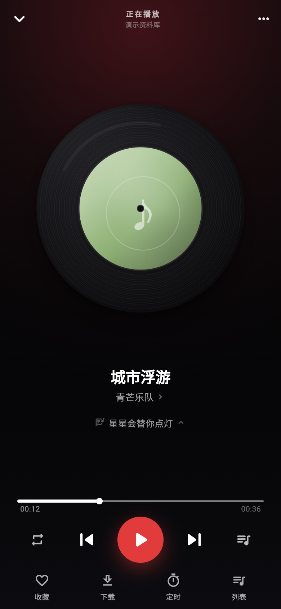
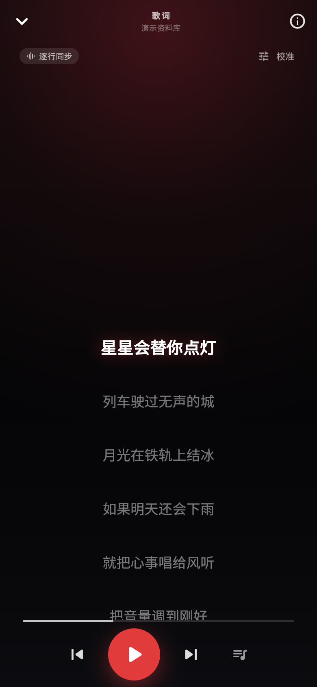
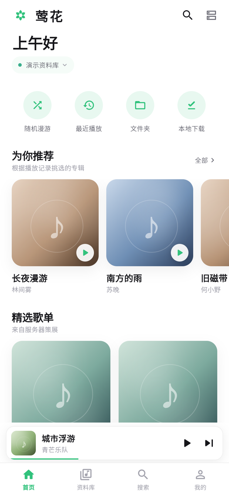
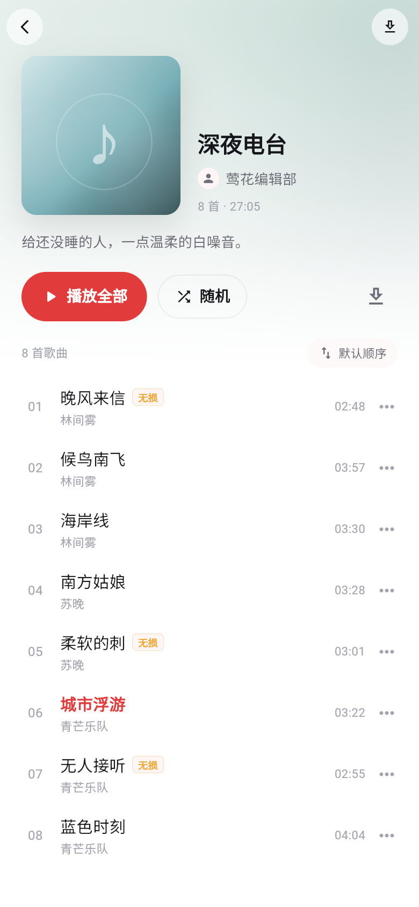

# 莺花 · YingHua

一个独立开发、无会员体系的 Flutter 音乐播放器，协议层对接 **Navidrome / Subsonic**（预留 Jellyfin / Emby 扩展位）。
视觉以品牌粉 + 白底黑字为主，播放页为沉浸式黑胶 + 逐行歌词。


> LOGO 主标识为「黑胶唱片 + 音符镂空」（`brand/vinyl-mark.svg`），
> 早期三套鸟与莲花的方案保留在 [`brand/README.md`](brand/README.md) 里。

> 所有功能默认开放：下载、桌面歌词、回放增益、定时停止、多服务器、文件夹视图、主题切换、首页自定义、备用线路、DLNA 入口等，
> 代码里没有任何付费 / 会员 / 支付 / 解锁判断。

## 截图

| 首页 | 播放页 | 歌词页 |
| --- | --- | --- |
|  |  |  |

| QQ 音乐主题 | 文件夹浏览 | 歌单排序 |
| --- | --- | --- |
|  |  |  |

390 × 844 逻辑分辨率 @2x 截图，使用内置「演示资料库」生成，不依赖真实服务器。

## 功能一览

**协议与账号**

- Navidrome / Subsonic token 登录（`md5(password + salt)`），不保存明文密码
- 主线路 + 备用线路自动故障转移；Token 失效给出明确提示
- **IPv6 服务器地址**：支持 `http://[2409:8a62::1]:4533`，也兼容漏写方括号的粘贴形式
- 多服务器管理与快速切换，演示资料库可离线体验

**浏览**

- 首页：快捷入口、为你推荐（大图歌单卡片）、精选歌单、最近添加、最近播放
- 资料库：专辑 / 歌手 / 歌单 / 文件夹四种视图
- **文件夹视图**：按服务器目录浏览；接口超时会给出提示并自动提供「按歌手浏览」兜底
- 搜索：歌曲、专辑、歌手聚合结果与搜索历史
- **排序入口**：歌单与搜索结果支持「默认顺序 / 标题 / 歌手 / 专辑 / 时长 / 年份」排序，歌单默认保留服务器顺序
- 收藏、下载、最近播放独立页面

**播放**

- mp3 / flac / aac / m4a / wav / ogg / opus 直连播放
- **wma / ape / dsf / dff / tta / wv 等设备不支持的格式自动请求服务端转码为 mp3**（需 Navidrome 配置 ffmpeg）
- 后台播放、通知栏 / 锁屏 / 耳机控制（`audio_service` 前台服务，暂停也不降级）
- **后台播放保护**：通知权限、忽略电池优化、国产 ROM 自启动设置一键直达
- 顺序 / 随机 / 单曲循环、队列拖拽排序、下一首播放
- 边听边存（`LockCachingAudioSource` + 容量回收）、离线下载（含整张专辑）
- 回放增益（ReplayGain）、音质上限、跳过静音
- **定时停止**：15 / 30 / 60 分钟或「播完当前歌曲」，播放页操作区与设置页均可进入
- **跳过片头片尾**：歌单级设置（如有声书 / 广播剧），可手动指定片头、片尾秒数，应用到整个歌单并自动跳到下一集
- **DLNA 投屏**：SSDP 自动发现局域网 MediaRenderer，AVTransport 推流，支持暂停 / 停止 / 音量，切歌自动跟随；投屏期间手机本地完全静音，进度与通知栏状态跟随音箱；歌单的跳过片头在投屏时同样生效，手机拖动进度会回传到音箱

**歌词**

- OpenSubsonic `getLyricsBySongId`（结构化 + 逐行时间轴）优先
- 回退旧版 `getLyrics`（LRC / 纯文本）
- **可配置歌词接口**：自定义 URL 模板（优先级最高，可开关）
- 再回退 LRCLIB 在线歌词接口（`/api/get` 精确匹配 → `/api/search` 模糊匹配），可关闭
- 歌词逐行高亮、点击跳转、上滑歌词页、歌词偏移校准（±2 分钟）：默认只作用于当前歌曲，在歌单页可选择应用到整个歌单
- **字符集兼容**：UTF-8（含 BOM）、UTF-16、GBK / GB18030、Shift_JIS、EUC-JP/KR 自动识别，GBK 歌词不再乱码
- 桌面歌词：应用内可拖拽悬浮歌词

**视觉与个性化**

- **6 套主题皮肤**：莺花、网易云音乐、QQ 音乐、酷我音乐、酷狗音乐、千千静听，一键切换主色、品牌浅底与界面底色
- 浅色 / 深色 / 跟随系统，皮肤与亮暗模式可自由组合
- 黑胶封面旋转、左右滑动切歌、上滑歌词
- 常驻迷你播放条（封面 + 进度 + 播放/下一首），首页、歌单、专辑、歌手、文件夹等页面都能直接看到
- 首页模块可排序、可隐藏
- 封面：服务器封面 → 本地离线封面 → 程序化占位封面；**封面磁盘缓存**，二次进入秒开
- **封面接口可配置**：默认走 Navidrome getCoverArt，也可换成任意返回图片的 URL 模板
- **歌词接口可配置**：服务器歌词 → 自定义接口 → LRCLIB，顺序与开关都能改

## 接口配置

「设置 → 接口」里可以替换封面与歌词的数据来源，适合服务器封面缺失、或想接自己的接口。

**封面接口**（`{id}` `{size}` `{album}` `{artist}` `{title}`）：

```
https://api.example.com/cover?artist={artist}&album={album}&size={size}
```

接口直接返回图片即可；占位符按 URL 编码替换，缺失值自动留空。
配置页提供「测试接口」按钮：会用示例专辑实际请求一次，显示 HTTP 状态、Content-Type、大小与缩略图。
`api.example.com` 这类示例域名会被拒绝保存；自定义接口加载失败时会自动回退到服务器封面。

> 提示：`api.lrc.cx` 这类接口会 302 跳到 Apple Music 图床，而它的 301 响应不带 CORS 头，
> 所以**网页预览**会被浏览器拦截（此时自动回退服务器封面）；Android 端由 App 自己跟随跳转，
> 工作正常。App 还会把 Apple 图床的大图统一降到 720 像素（例如 1.9 MB → 179 KB）。

**歌词接口**（`{id}` `{title}` `{artist}` `{album}` `{duration}`）：

```
https://api.example.com/lyric?title={title}&artist={artist}
```

返回 LRC 纯文本，或 JSON（自动读取 `lrc` / `lyric` / `lyrics` / `text` / `content`，
兼容 `data`、`result` 包裹）。填写后优先级高于 LRCLIB；关闭「在线歌词补全」也不会影响自定义接口。

## 目录结构

```
lib/
  app.dart                  # Provider 装配 + MaterialApp
  main.dart                 # 初始化（设置、音源、下载、播放）
  core/
    theme/                  # 皮肤预设、颜色、字阶、间距、圆角、阴影、ThemeData
    utils/                  # 格式化、LRC 解析、URL（含 IPv6）、URL 模板、音频格式策略
  data/
    models/                 # Song / Album / Artist / Playlist / Lyric / ServerConfig
    sources/                # MusicSource 接口 + Subsonic 实现 + 演示资料库 + 在线歌词
    repositories/           # LibraryRepository（带 TTL 缓存）
    local/                  # 设置、下载、收藏、封面缓存
  playback/                 # 播放控制、audio_service 适配、音频缓存
  ui/
    home_shell.dart         # 底部导航 + 迷你播放条 + 悬浮歌词
    pages/                  # 首页、资料库、搜索、我的、播放页、设置、接口配置等
    widgets/                # 封面、黑胶、歌词、队列、卡片等
    sheets/                 # 歌曲操作、定时停止、歌词校准、歌曲信息
tool/screenshots/           # 截图专用 Web 入口与 390×844 iframe 外壳（不参与 APK）
docs/                       # 设计规范、自查报告、截图
test/widget_test.dart       # 解析 / 格式 / URL 单元测试
```

## 开发与构建

环境：Flutter 3.50（Dart 3.14）、JDK 21、Android SDK 36、Gradle 9.5 / AGP 9.3.1（Flutter 3.50 模板要求）。

```bash
flutter pub get
flutter analyze
flutter test
flutter build apk --release     # build/app/outputs/flutter-apk/app-release.apk
```

安装：把 APK 拷贝到 Android 手机后直接安装（已使用仓库内 `yinghua-release.jks` 签名）。

### 关于 wma 等格式

ExoPlayer / AVPlayer 无法解码 wma、ape、dsf 等容器，因此播放器会把这类音轨的 `stream` 请求改为
`format=mp3&maxBitRate=320`，由服务端转码。Navidrome 需要安装 **ffmpeg** 并开启转码，否则会返回原始文件，
此时界面会提示「设备无法直接解码，请在 Navidrome 中开启转码」。

### 关于歌词

服务器没有歌词时，会请求公开接口 `https://lrclib.net`（无需 Key）。若不需要外网请求，可在
「设置 → 歌词 → 歌词接口」关闭在线歌词。

如果服务器返回的歌词是一串 `�`（或 `锟斤拷`），说明 Navidrome 把 GBK 编码的 `.lrc`
当成 UTF-8 读入了数据库，原始字节已经丢失。App 会自动识别这类不可逆乱码并改用在线歌词，
同时在歌词页标注来源（`· LRCLIB` / `· 自定义接口`）。

要彻底修复，把歌词文件转成 UTF-8 后重新扫描即可：

```bash
find /path/to/music -name '*.lrc' -print0 | while IFS= read -r -d '' f; do
  iconv -f UTF-8 -t UTF-8 "$f" >/dev/null 2>&1 && continue
  iconv -f GB18030 -t UTF-8 "$f" > "$f.tmp" && mv "$f.tmp" "$f"
done
```

### 关于字符集

接口响应与歌词正文会先取字节再解码：优先 BOM 与 `Content-Type` 的 charset，其次是严格 UTF-8，
失败后依次尝试 GBK / GB18030、Shift_JIS、EUC-JP、EUC-KR，最后 Latin-1 兜底。
对于「UTF-8 里套着 GBK 乱码」的二次编码，也会在标题、歌手、歌词上做一次保守修复。

## 已知边界

- 网页预览版（`flutter build web`）仅用于演示与截图，不支持离线下载、桌面歌词悬浮与系统媒体通知。
- DLNA 需要手机与电视 / 音箱在同一局域网，且设备开启 UPnP / DLNA；部分设备不支持音量控制。
- 评论功能未做：Subsonic 协议没有评论接口，播放页以「歌曲信息」替代。
- CarPlay / 快捷指令受 iOS 平台限制，Android 侧以媒体通知与耳机按键覆盖同等场景。
